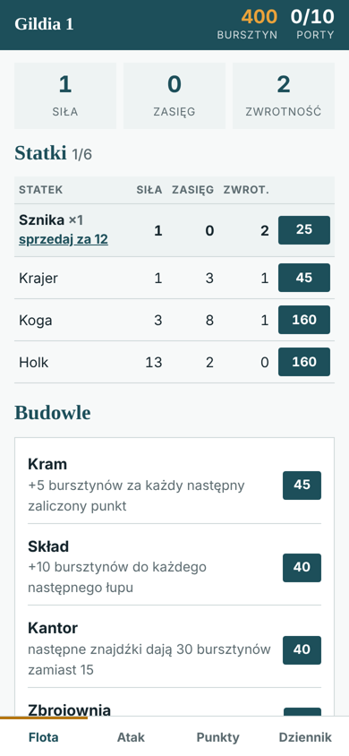
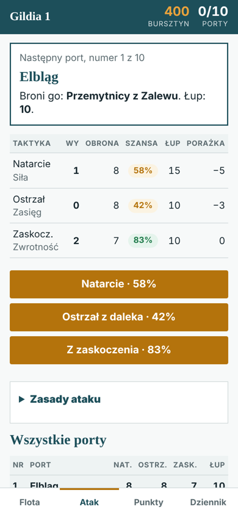
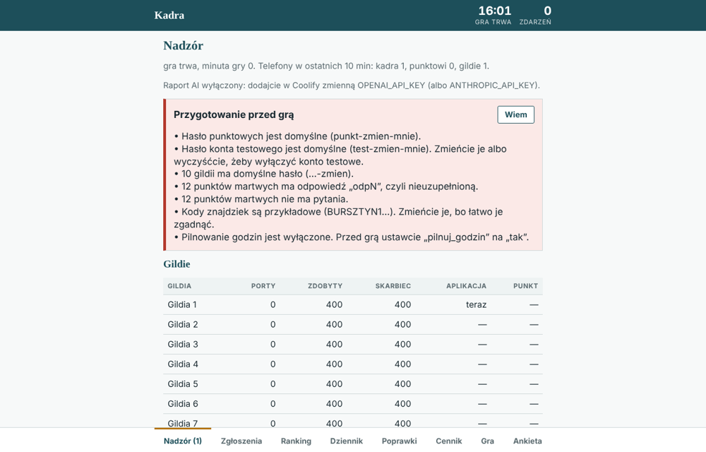

# Bursztynowe Miasto

A city game for scouts, played on the streets of Gdańsk with a phone app as the game board. Teams ("guilds") earn amber at real-world checkpoints, spend it on ships and buildings in the app, and attack ten Hanseatic ports one by one.

Played in October 2026 by **30 players in 10 guilds**. The server logged 454 game events, and in the post-game survey players rated the game **4.5/5** and the app **5/5**.

<p>
  
  
</p>

## How the game works

- **Earning amber.** Guilds visit staffed checkpoints, where the staff member scores the task, answer questions at unstaffed checkpoints (text or a photo, reviewed by staff) and type in codes from hidden cards.
- **Building a fleet.** Ships have three stats (strength, range, agility) and buildings give bonuses to later rewards. Players choose what to buy.
- **Attacking ports.** Each port is defended differently against each of three tactics. The app shows the chance of success before the dice roll. A failed attack raises that port's defence, so blind retries stop paying off.
- **SET mini-game.** From the third port on, a guild can play a quick round of SET before attacking to gain a bonus.

The full rulebook for players is in [docs/instrukcja-dla-gildii.pdf](docs/instrukcja-dla-gildii.pdf) (Polish).

## Staff panel

The same app has views for checkpoint staff and for the game master.



- **Oversight rules** flag inactive guilds, long debts, losing streaks, checkpoints with many wrong answers and the game's pace compared with the simulated plan.
- **AI report** (optional): every 15 minutes the game state goes to the Anthropic or OpenAI API, and staff get a short list of what needs action now.
- Submission review, ranking, event log, manual corrections, CSV/JSON export and a post-game survey.

## Design and balancing

Before the game the economy (prices, rewards, port defences) was tuned with simulated games. The oversight panel compares the real pace with that plan, and staff can change prices and give bonuses live when the game runs slower or faster than expected.

What players said they liked most: the app itself, clear rules and not having to carry a paper patrol card. What they would change: more buildings and ships to buy, and more hidden cards.

## Tech

- Node.js 20+, **no external dependencies**, one process, state kept in JSON files with atomic writes.
- Mobile-first single-page app in plain JavaScript (`public/index.html`).
- Dockerfile; deployed with Coolify.
- 30 automated tests: `npm test` (Node's built-in test runner).

Built with AI-assisted development (Claude Code): I designed the game and ran it live, and most of the code was written with Claude Code under my direction.

## Running locally

```bash
HASLO_KADRY=your-staff-password npm start   # http://localhost:3000
```

Log in with the staff password, then set guild names and passwords in the **Cennik** tab. The full setup and deployment guide is in [docs/WDROZENIE.md](docs/WDROZENIE.md) (Polish).

Author: [Maciej Karwik](https://github.com/mkarwik)
